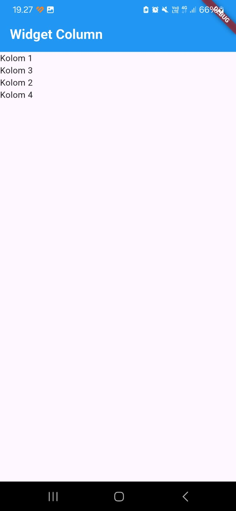
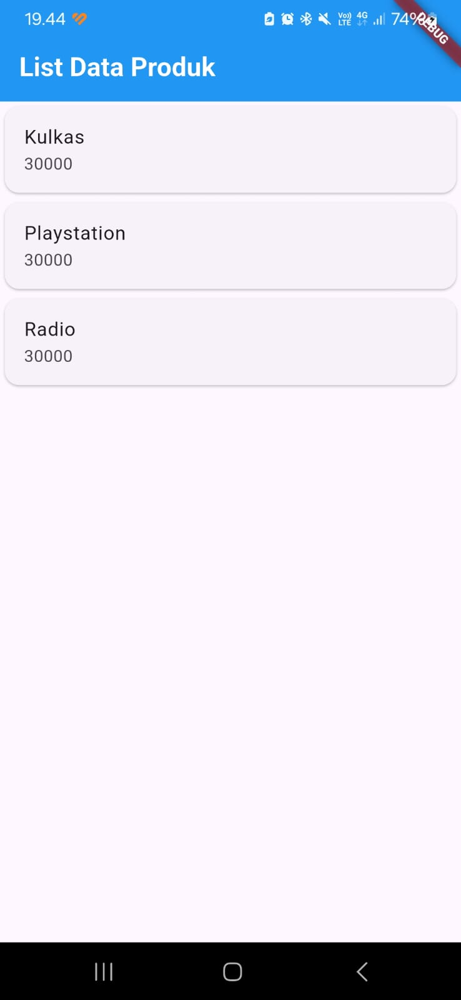

# Laporan Praktikum Pemrograman Mobile - Flutter

**Nama**        : Nindya Alif Romland   
**NIM**         : H1D024031   
**Shift**       : Awal D / Akhir E   
**Praktikum**   : Pemrograman Mobile

---

## 📝 Tugas Pertemuan 1
**Tanggal**: Rabu, 28 Oktober 2026

**Deskripsi Teknis & Non-Teknis:**
- **Non-Teknis:** Pengenalan dasar framework Flutter, pembuatan struktur folder proyek, serta pemahaman tata letak dasar antarmuka pengguna mobile.
- **Teknis:** 
  - Mengimplementasikan `Scaffold` dan `AppBar` dengan warna biru dan teks judul tebal (*bold*).
  - Membuat layout vertikal (`Column`) dan horizontal (`Row`).
  - Mengimplementasikan form input (`TextField` dengan `TextEditingController`) dan navigasi halaman (`Navigator.push`) dari `ProdukForm` ke `ProdukDetail`.
  - Menampilkan daftar data menggunakan `ListView`, `Card`, dan `ListTile`.

**Kesimpulan Praktikum:**  
Praktikum pertama memberikan pemahaman mendalam tentang penggunaan widget dasar di Flutter, pengelolaan form input, navigasi antar halaman, serta penyusunan daftar item menggunakan ListView.
