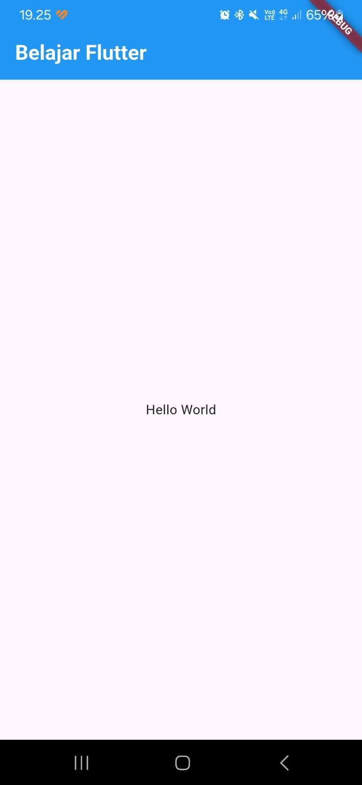
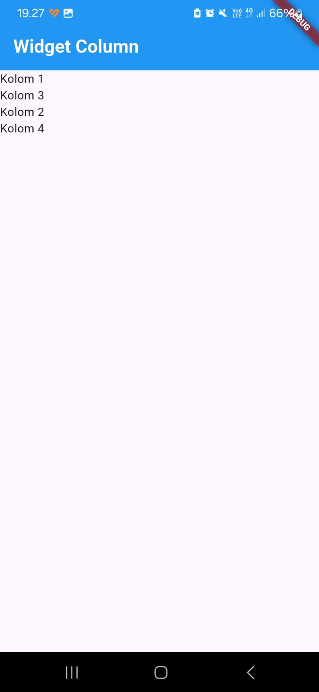
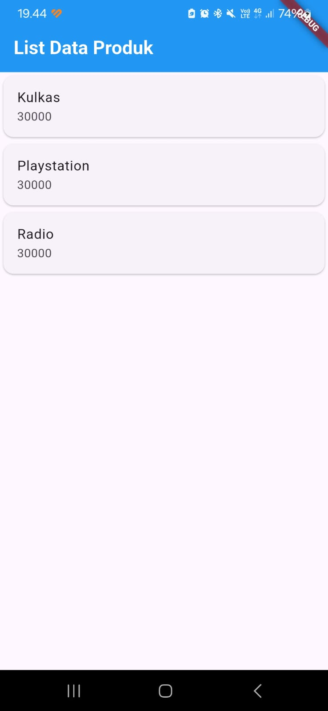

# Laporan Praktikum Pemrograman Mobile - Flutter

**Nama**        : Nindya Alif Romland   
**NIM**         : H1D024031   
**Shift**       : Awal D / Akhir E   
**Praktikum**   : Pemrograman Mobile

---

## 📝 Tugas Pertemuan 1: Bahasa Pemrograman Dart
**Tanggal**: 21 Oktober 2026

**Deskripsi Teknis & Non-Teknis:**
- **Non-Teknis:** Pengenalan dasar bahasa pemrograman Dart sebagai fondasi utama pengembangan aplikasi multi-platform menggunakan Flutter. Mempelajari konsep dasar pemrograman berorientasi objek (OOP), eksepsi, serta pemrograman asinkronus.
- **Teknis:** 
  - Mencoba dasar Dart secara online menggunakan **DartPad** (`https://dartpad.dev`).
  - Mempelajari tipe data (`int`, `double`, `String`, `bool`, `var`), operasi matematika, dan logika.
  - Implementasi struktur kontrol, percabangan, dan fungsi.
  - Pembuatan Kelas (*Class*) dan Objek (*Object*), penggunaan statement `import`, penanganan eksepsi (`try-catch`), serta pengelolaan operasi asinkronus menggunakan `async` dan `await`.

**Kesimpulan Praktikum:**  
Pertemuan pertama memberikan pemahaman mengenai sintaks dan fitur inti dari bahasa pemrograman Dart yang menjadi dasar esensial sebelum membangun antarmuka aplikasi dengan Flutter.

---

## 📝 Tugas Pertemuan 2: Widget & Design Flutter
**Tanggal**: Rabu, 28 Oktober 2026

**Deskripsi Teknis & Non-Teknis:**
- **Non-Teknis:** Pengenalan dasar framework Flutter, pembuatan struktur folder proyek, serta pemahaman tata letak dasar antarmuka pengguna mobile.
- **Teknis:** 
  - Mengimplementasikan `Scaffold` dan `AppBar` dengan warna biru dan teks judul tebal (*bold*).
  - Membuat layout vertikal (`Column`) dan horizontal (`Row`).
  - Mengimplementasikan form input (`TextField` dengan `TextEditingController`) dan navigasi halaman (`Navigator.push`) dari `ProdukForm` ke `ProdukDetail`.
  - Menampilkan daftar data menggunakan `ListView`, `Card`, dan `ListTile`.

**Kesimpulan Praktikum:**  
Pertemuan kedua memberikan pemahaman tentang penggunaan widget dasar di Flutter, pengelolaan form input, navigasi antar halaman, serta penyusunan daftar item menggunakan ListView.

---

## 📝 Tugas Pertemuan 3: Login Page & Shared Preferences
**Tanggal**: [Tanggal Pertemuan 3]

**Deskripsi Teknis & Non-Teknis:**
- **Non-Teknis:** Memahami mekanisme autentikasi sederhana pada aplikasi mobile serta penyimpanan lokal (*local storage*) menggunakan `shared_preferences`.
- **Teknis:** 
  - Menambahkan dependencies `shared_preferences` pada `pubspec.yaml`.
  - Membuat halaman `LoginPage` (`login_page.dart`) dengan `StatefulWidget`, `TextEditingController` untuk username & password, serta fungsi `_saveUsername()` untuk menyimpan data ke penyimpanan lokal secara asinkronus (`async`/`await`).
  - Mengimplementasikan validasi login (username dan password `admin`) dengan menampilkan dialog *alert* (`showDialog`) serta navigasi ke `HomePage` jika berhasil atau kembali ke `LoginPage` jika salah.

**Kesimpulan Praktikum:**  
Pertemuan ketiga memberikan pemahaman tentang cara mengintegrasikan plugin pihak ketiga (`shared_preferences`) untuk penyimpanan data lokal serta membangun alur autentikasi dan dialog interaktif di Flutter.
